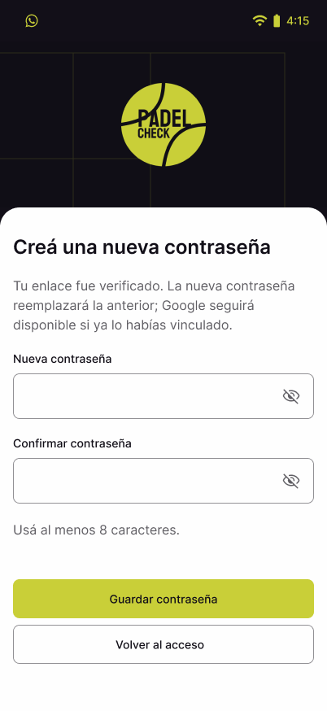
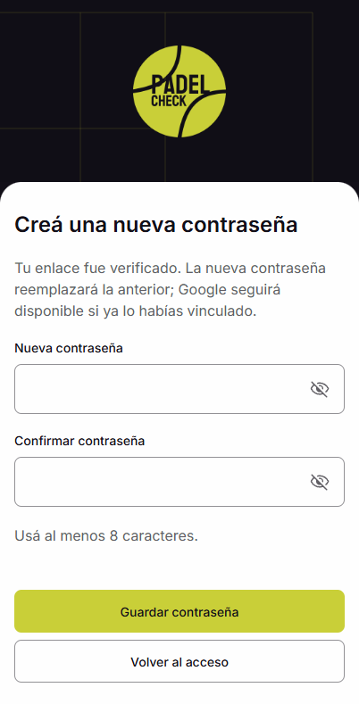

# KAN-214 — responsive web recovery

Verified 03/11/2026 against integrated service contract v1.1 (PRs #10/#12), using
an isolated local PostgreSQL schema and a loopback SMTP receiver. No demo data or
external recipients were used. `web-results.json` records eight browser suites;
`cors-results.json` records the real cross-origin rate-limit check.

The login opens `/forgot-password`; email links open `/reset-password`. Inspection
selects CREATE_PASSWORD/RESET_PASSWORD exclusively from the server. Proof is removed
from history before router creation, kept in memory, and sent only in POST bodies.
The HTML and hosting headers apply no-referrer; recovery requests omit credentials.
Save clears the previous local session/private cache before showing success. A local
cleanup failure offers retry without resubmitting the already-consumed proof.

## Visual comparison

References: KAN-223 `2887:45731`, `2887:45836`, `2887:45910`, `2887:45984` in
[Figma](https://www.figma.com/design/6ChpVD5gKDoC3kRXoGdVdK/Padel-check?node-id=2887-45731).
KAN-212 supplies generic confirmation, validation and unavailable-link copy.
Current KAN-223 supersedes the original KAN-213 form headings and success variant.

Compared at 402 px width. Reference is 402×874 including illustrative 51 px system
status and 34 px bottom inset; web content is 402×789, excluding those 85 px. Web
does not draw system bars. The 204 px brand, original 104×102.525 logo, exact exported
402×228 court, Inter weights, 24/32 heading, 16/24 body, 56 px inputs, 48 px buttons,
8/24 px radii, 20 px content gaps, colors and icons were inspected. Corrected field
utility precedence and local fonts before recapture. Footer consumes actual browser
safe-area plus 24 px; short screens/keyboard can scroll instead of clipping actions.

Reference reset:

Running reset, same logical content area:

Other comparable pairs: [request reference](figma-request.png) / [runtime](web-request.png),
[first password reference](figma-create.png) / [runtime](web-create.png),
[success reference](figma-success.png) / [runtime](web-success.png).
Additional captures cover field errors, sent/used link, inspection failure, Save loading
and 429. Widths 320/360/390/402/600/767 have no horizontal overflow; footer reachable.
Desktop composition remains outside KAN-214; wide viewports retain the mobile flow.

## Verification

- `npm run build`: pass, explicit local API base. Existing large-chunk warning.
- `npm run test:recovery`: 14 passing; `test:http`: 24 passing; `test:session`: 11
  passing; `test:startup`: 9 passing. Final checks used Node 24.
- Targeted ESLint of changed recovery/transport TypeScript: pass. Whole-repo lint
  retains its existing unused `_props` error in `CategoryEnrollFab.tsx` and five
  existing fast-refresh warnings.
- Real API/browser: local and passwordless accounts, repeated non-consuming
  inspection, explicit Save, old session rejected with 401, new login, used/expired/
  replaced proof, blocked and unverified eligibility retained, missing proof,
  generic unknown-account confirmation, field validation and responsive layouts.
- Directed browser failures: 503/retry, unknown capability fails closed, Save 429
  preserves fields, busy single-flight and Retry-After. Real cross-origin 429 also
  verified after the companion service CORS fix: readable deadline, disabled retry.
- Focus moves to stage heading/first invalid field; labels, described field errors,
  live announcements, keyboard navigation and scroll inspected. Password/proof are
  not written to storage, logs or analytics.

Guard lite: pass for this diff; no Critical findings. No new permissions, tenant
selection, auto-login or account duplication. Google authentication remains KAN-231;
passwordless recovery does not claim real Google sign-in coverage.

Android evidence is in the mobile PR. iOS bundle export passes; installed iOS
cold/warm opening, keyboard, safe areas and visual acceptance remain unverified on
this Windows host without Mac/Xcode or a connected installed iOS build. No iOS AC
is accepted based on web/Android evidence. No merge or deploy performed.
